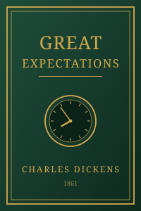

<a href="https://github.com/hamza-x82ik/hamza-x82ik">
  <picture>
    <source media="(prefers-color-scheme: dark)" srcset="https://raw.githubusercontent.com/hamza-x82ik/hamza-x82ik/main/dark_mode.svg">
    
  </picture>
</a>

## Projects

| Project | What it is | Built with |
|---|---|---|
| [FacilityFlow](https://github.com/hamza-x82ik/facilityflow) | Campus maintenance & incident platform with photo proof, escalation and reminders. **Top 5** at the Fastn Online Hackathon 2026. | Fastn |

## Favourite ebooks

